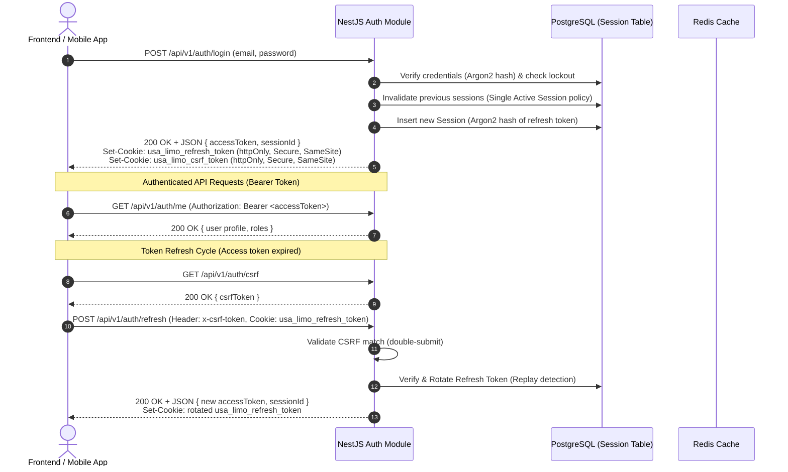

# Security & Authentication Architecture

USA Limousine Corporation employs a defense-in-depth security model engineered to protect sensitive customer data, financial transactions, and driver records against modern web and API threat vectors.

---

## 🔐 Hybrid Authentication Protocol

The authentication subsystem utilizes a **Hybrid Session Model** combining short-lived Access JSON Web Tokens (JWT) with rotating, secure httpOnly Refresh Tokens.



### Key Security Principles

1. **Access Tokens in Memory Only:** Browser applications never store access tokens in `localStorage` or `sessionStorage` (mitigating XSS extraction risks).
2. **Refresh Tokens in httpOnly Cookies:** The refresh token (`usa_limo_refresh_token`) cannot be read by client JavaScript. It is scoped to the API domain with `Secure` and `SameSite` flags.
3. **Argon2 Token Hashing:** Refresh tokens are never stored in plaintext. PostgreSQL persists an Argon2 cryptographic hash of the token.
4. **Token Rotation & Replay Revocation:** Every refresh call generates a new refresh token and rotates the hash. If a previously consumed refresh token is presented (replay attack), the entire session is immediately revoked.
5. **Single Active Session Policy:** Logging in on a new device revokes all prior active sessions for that user account.

---

## 🛡️ CSRF Mitigation (Double-Submit Cookie Pattern)

Cross-Site Request Forgery (CSRF) protection is strictly enforced on cookie-authenticated state-changing operations:

- **Endpoint:** `POST /api/v1/auth/refresh`
- **Mechanism:** Double-Submit Cookie Guard (`CsrfGuard`).
  1. The client requests a CSRF token via `GET /api/v1/auth/csrf`.
  2. The server sets an httpOnly cookie (`usa_limo_csrf_token`) and returns `{ csrfToken: "..." }` in the response body.
  3. On refresh, the client submits the token in the `x-csrf-token` header, and the browser automatically attaches the cookie.
  4. `CsrfGuard` verifies that the header token matches the cookie token before `RefreshAuthGuard` executes.
- **Fail-Closed:** Missing or mismatched CSRF tokens return `403 Forbidden` without evaluating credentials.
- **Bearer Exception:** Stateless API requests authenticated solely via `Authorization: Bearer <token>` do not require CSRF protection, as browsers never attach Bearer headers automatically.

---

## 👥 Role-Based Access Control (RBAC)

Authorization is enforced at the controller and route level using NestJS decorators (`@Roles(...)`) evaluated by `RolesGuard`.

### Platform Role Hierarchy

| Role Key      | Name                 | Access Scope & Responsibilities                                                                                      |
| :------------ | :------------------- | :------------------------------------------------------------------------------------------------------------------- |
| `SUPER_ADMIN` | Super Administrator  | Global platform control: driver approvals, pricing management, manual payouts, and system audit logs                 |
| `EMPLOYEE`    | Operations Staff     | Fleet monitoring (`ops:fleet`), customer support tickets, and ride dispatch coordination                             |
| `DRIVER`      | Limousine Driver     | Mobile application access: shift status, live trip GPS streaming, in-trip audio, wallet balance, and payout requests |
| `CUSTOMER`    | Registered Passenger | Web portal & mobile app: ride booking, quote reviews, Square checkout, trip history, and driver reviews              |

### Route Protection Matrix

```ts
// Example NestJS RBAC enforcement
@Controller('admin/payouts')
@UseGuards(JwtAuthGuard, RolesGuard)
@Roles('SUPER_ADMIN')
export class AdminPayoutsController {
  @Post(':id/approve')
  async approve(@Param('id') id: string) { ... }
}
```

---

## 🔒 Session Lifecycle & Brute-Force Defense

### Account Lockout Policy

- **Maximum Consecutive Failures:** Configurable via `AUTH_LOGIN_MAX_ATTEMPTS` (default: 5 attempts).
- **Lockout Duration:** Configurable via `AUTH_LOCKOUT_MINUTES` (default: 15 minutes).
- **Auditing:** Every failed attempt, lockout trigger, and successful login is recorded in the `AuditLog` table with timestamp, IP address, and user agent.

### Session Revocation Triggers

A user session is invalidated under the following conditions:

- Explicit logout (`POST /api/v1/auth/logout`)
- Global logout across all devices (`POST /api/v1/auth/logout-all`)
- Password change or password reset completion
- Refresh token replay detection
- Administrative suspension by a `SUPER_ADMIN`

When a session is revoked, active WebSocket connections for that session receive `auth:session_revoked` and are immediately disconnected.

---

## 🌐 Network Security & Transport Hardening

1. **Automated TLS Encryption:** All ingress traffic is terminated by Caddy with modern TLS 1.3 ciphers and automatic certificates via Let's Encrypt.
2. **CORS Allowlisting:**
   - Production forbids wildcard (`*`) origins.
   - Allowed origins are explicitly enumerated: `https://demo.usalimocorp.com`, `https://admin.usalimocorp.com`, `https://customer.usalimocorp.com`.
3. **HTTP Security Headers (Helmet):**
   - Content Security Policy (CSP)
   - HTTP Strict Transport Security (HSTS) with `max-age=31536000; includeSubDomains`
   - X-Content-Type-Options: `nosniff`
   - X-Frame-Options: `DENY`
4. **Rate Limiting & Abuse Prevention:**
   - Global rate limiter on public routes.
   - Sensitive endpoints (OTP resend, checkout creation, password reset) protected with dedicated Redis-backed throttlers.
