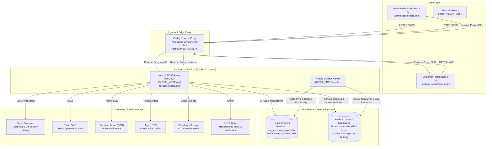
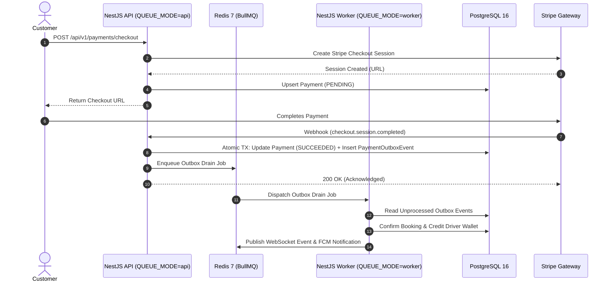

# System Architecture & Platform Overview

The USA Limousine Corporation platform is an enterprise-scale, multi-tenant SaaS transportation platform powering on-demand and pre-scheduled limousine bookings, real-time driver dispatch, GPS fleet tracking, driver payout processing, and platform administration.

---

## 🏛️ System Context Architecture



---

## 📦 Monorepo Workspace Topology

The repository follows a clean Turborepo monorepo structure with strict boundary enforcement:

```text
usa-limousine-corporation/
├── apps/
│   ├── backend/        # NestJS 11 Core API & Worker Service (@usa-limousine-corporation/backend)
│   ├── admin/          # Super Admin Next.js 15 Dashboard (@usa-limousine-corporation/admin)
│   └── customer/       # Customer Portal Next.js 15 Web App (@usa-limousine-corporation/customer)
├── packages/
│   └── ui/             # Shared UI Component Library, Tokens & Layouts (@usa-limousine-corporation/ui)
├── docs/               # System Architecture, API Specs, and Runbooks
├── deploy/             # VPS Compose configuration, Caddyfile, and deployment automation
└── tests/              # Cross-workspace Playwright E2E and integration tests
```

### Dependency Graph Rules

1. **Top-Down Dependency Flow:** Applications (`apps/*`) depend on packages (`packages/*`). Packages **never** depend on applications or sister packages.
2. **Zero Inter-App Coupling:** `apps/admin` and `apps/customer` never share code or models directly. Common UI abstractions reside in `@usa-limousine-corporation/ui`.
3. **Transport Facade Isolation:** API client transport logic is implemented inside each dashboard's `lib/http/` facade, preventing cross-tenant leakage.

---

## 🗄️ Domain-Driven Database Architecture (Prisma)

The persistence layer uses PostgreSQL 16 managed through a multi-file domain-split Prisma schema in `apps/backend/prisma/schema/`:

| Schema File           | Bounded Context / Domain Responsibilities                                                                            |
| :-------------------- | :------------------------------------------------------------------------------------------------------------------- |
| `schema.prisma`       | Core datasource and client generator configurations                                                                  |
| `users.prisma`        | User entity, profiles, and demographic records                                                                       |
| `roles.prisma`        | RBAC: `RoleKey`, `Role`, `Permission`, `UserRole`, `RolePermission`                                                  |
| `auth.prisma`         | Session management, Argon2 refresh token hashes, email verification & password reset tokens                          |
| `audit.prisma`        | Immutable audit log records for compliance and security events                                                       |
| `driver.prisma`       | Driver profiles, vehicle assignments, KYC compliance documents, license status                                       |
| `vehicle.prisma`      | Vehicle categories, capacities (passengers, luggage), make/model registries                                          |
| `booking.prisma`      | Customer booking records, trip pricing breakdown, pickup/dropoff points, booking status                              |
| `trip.prisma`         | Driver trip execution lifecycle, trip status transitions (`STARTED`, `ARRIVED_AT_DROPOFF`, `COMPLETED`), trip events |
| `payment.prisma`      | Payment transactions, payment attempts, Stripe session mapping, transactional outbox events                          |
| `notification.prisma` | In-app notification inboxes for drivers and customers, push gating configuration                                     |
| `wallets.prisma`      | Driver financial wallet, balances, and immutable transaction ledger                                                  |
| `payouts.prisma`      | Driver payout requests, bank transfer snapshots, and lifecycle event logging                                         |
| `shared.prisma`       | Cross-domain enums, reusable scalar types, and system-wide constants                                                 |

---

## ⚡ Asynchronous Processing & Queue Topology (BullMQ)

High-throughput, asynchronous workloads are isolated using Redis-backed BullMQ queues. In production, process roles are strictly split via `QUEUE_MODE`:



### Queue Modes & Scalability

| Mode     | Command                  | Responsibility                                                                                 | Production Topology              |
| :------- | :----------------------- | :--------------------------------------------------------------------------------------------- | :------------------------------- |
| `all`    | `pnpm dev`               | Monolithic mode: HTTP API, WebSockets, and BullMQ workers run in a single process              | Local development only           |
| `api`    | `pnpm start:prod`        | Stateless HTTP & WebSocket gateway: handles requests, enqueues background jobs                 | Scales horizontally behind Caddy |
| `worker` | `pnpm start:prod:worker` | Background worker daemon: processes queues (emails, FCM push, outbox drain, billing reconcile) | Scales based on queue depth      |

---

## 📡 Real-Time WebSocket Architecture (Socket.IO)

The platform provides a bi-directional event stream powered by Socket.IO with a Redis adapter for cross-instance message broadcasting:

- **Authentication:** WebSocket connections authenticate via JWT bearer token during handshake.
- **Room Topology:**
  - `user:<userId>` — Targeted customer notifications, booking updates, and chat events.
  - `driver:<driverId>` — Targeted driver offers, trip assignment events, and wallet credits.
  - `drivers:cat:<categoryId>` — Vehicle category room for broadcasting available ride offers (`booking.available`).
  - `trip:<tripId>` — Active trip room joined by driver and passenger for real-time location streaming and call invites.
  - `ops:fleet` — Admin room for live map monitoring and fleet geospatial tracking.
- **High-Frequency GPS Ingestion:** Drivers stream coordinates every 3–10 seconds on active trips via `driver.location`. Redis caches the latest position (`trip:{id}:location`) with geospatial indexing, while a buffer flushes coordinates to PostgreSQL in batches to prevent database write exhaustion.

---

## 🛡️ Reliability & Resilience Patterns

1. **Transactional Outbox Pattern:** Stripe webhooks write payment updates and domain outbox events in a single PostgreSQL database transaction. BullMQ workers drain the outbox, ensuring domain events (booking confirmation, wallet credit) survive crashes and network partitions.
2. **Idempotency Guarantees:** Webhook processing dedupes events via `PaymentWebhookEvent`. Stripe payment sessions use deterministic idempotency keys (`checkout:{paymentId}:{amountCents}`).
3. **Graceful Degradation:** Optional third-party providers (Stripe, Twilio, Firebase, Agora) report `not_configured` in `/api/v1/health` without blocking startup or failing critical health probes.
4. **Health Check Probes:** Deep health monitoring on `GET /api/v1/health` probes PostgreSQL, Redis, BullMQ, storage, and mailer availability.
